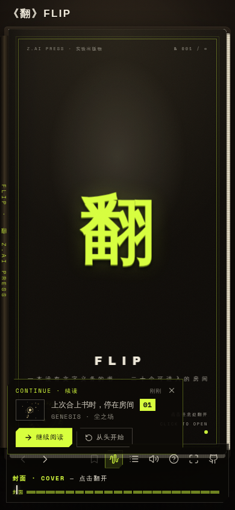
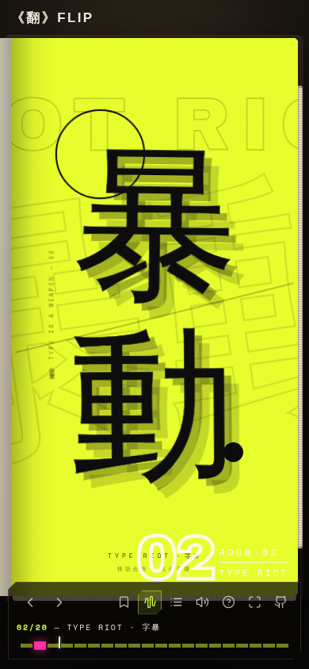

<div align="center">

# 《翻》 FLIP

**一本可以翻阅的实验数字艺术书 · 二十个房间**

封面、书脊、纸张、3D 翻页与页码。<br/>
每一页是一件独立的交互艺术品——生成艺术、声音装置、粒子实验、街机游戏、视觉谜题。<br/>
没有必读的顺序，也没有读完的义务。

[翻开它](#-翻开它) · [二十个房间](#-二十个房间) · [从源码运行](#-从源码运行) · [单文件版构建](#-单文件版构建)

</div>

<p align="center">
  
</p>

<p align="center">
  
</p>

---

## 📖 翻开它

三种方式，任选其一：

1. **单文件版（推荐）** — 直接双击打开根目录的 [`index.html`](./index.html)。整个网站被构建进一个约 0.9MB 的 HTML 文件：JS、CSS、字体全部内嵌，零外部依赖，离线可用。
2. **从源码运行** — 见[下文](#-从源码运行)。
3. **克隆后本地打开** — `git clone` 本仓库，双击 `index.html` 即可。

> 合上书之后，二十个房间继续存在。你的阅读进度、书签与印章会留在这台设备的浏览器里。

## 🔖 阅读方式

- **翻页**：点击页角 / 按住页缘拖拽 / 键盘 `←` `→` `PgUp` `PgDn` `Home` `End` / 滚轮 / 底部 HUD 按钮
- **跳转**：目次点击条目快速连翻（riffle）；HUD 进度轨 20 格刻度直达房间
- **书签**：`B` 键或 HUD 书签钮标记当前房间，`M` 打开书签面板
- **声音**：全书翻页音、房间环境音均为 Web Audio 实时合成（HUD 可静音/开启环境音）
- **印章**：阅读时长、翻页数、探索房间数、通关房间等成就会烙在版权页的印谱上
- **通关房间**：06 引力剧场 · 07 生命游戏 · 15 躲避线 · 18 色觉 · 20 白 —— 五关齐破有彩蛋
- **响应式**：桌面 ≥1024px 为双页跨页（书脊居中、合书塌缩为封面）；窄屏自动切为单页模式

## 🚪 二十个房间

| # | 房间 | 一句话 |
|---|------|--------|
| 01 | GENESIS 尘之场 | 2200 粒尘埃在流场里漂移，指针是风 |
| 02 | TYPE RIOT 字暴 | 两枚巨字的弹簧物理，点击全体引爆 |
| 03 | INK 墨潮 | 一汪可搅动的活墨海（稳定流体），朱砂每五发 |
| 04 | GLITCH GARDEN 故障花园 | 三色版分离的 RGB 故障植被，点击栽种 |
| 05 | MOIRÉ 干涉 | 双光栅摩尔纹，拖动/甩动圆盘，点击换纹样 |
| 06 | ORBIT 引力剧场 ✦ | 弹弓发射行星的恒星系沙盒（可通关） |
| 07 | LIFE 生命游戏 ✦ | 会盖印的生命游戏，四种图案待你看全 |
| 08 | THE WELL 井 | 欧普隧道，按住疾坠 |
| 09 | SOUND POND 声之池 | 点击水面，五声音阶的涟漪与回声 |
| 10 | FLOCK 群鸟 | 150 只 boids，按住惊散 |
| 11 | TERMINAL 终端之环 | ASCII 字符 3D 环面，CRT 辉光 |
| 12 | FERROFLUID 磁流 | 指针即磁体，靠近即尖峰林立的铁磁流体皿 |
| 13 | MANDELBROT 无限海岸 | 渐进渲染的分形探索，点击缩放 |
| 14 | BLOOM 开花 | 递归分形树的四季轮回 |
| 15 | NEON DASH 霓虹疾驰 ✦ | 擦弹计分的街机躲避（可通关） |
| 16 | PHOSPHENE 磷光 | 按住闭眼：涟漪→辐条→蜂窝的视像生长 |
| 17 | VERTIGO 字之涡 | 11 环 400 字形的 3D 排版龙卷风 |
| 18 | CHROMA 色觉 ✦ | 找不同色块，关卡渐密渐难（可通关） |
| 19 | VOICEPRINT 声纹 | 特雷门琴示波器，指针即音高 |
| 20 | WHITE 白 ✦ | 极简终章，600 粒子拼出一个「完」 |

✦ = 可通关房间

## 🛠 从源码运行

```bash
bun install
bun run dev        # http://localhost:3000
```

技术栈：**Next.js 16（App Router）· React 19 · TypeScript · Tailwind CSS 4 · Zustand · Canvas 2D / Web Audio**。纯客户端交互艺术，无后端、无数据库依赖。

```
src/
├── app/                    # 路由入口与全局样式（globals.css 约 3000 行书引擎样式）
├── lib/
│   ├── book/pages.ts       # 26 个书页表面注册表（封面/扉页/目次/20 房间/版权页/封底）
│   ├── book-store.ts       # Zustand 全局状态（静音/书签/印章/阅读档案，localStorage 持久化）
│   └── book/sound.ts       # Web Audio 合成翻页声
├── hooks/use-spread.ts     # 桌面跨页 / 移动单页自适应
└── components/
    ├── book/               # 书壳引擎：3D 翻页状态机、叶子、书框、HUD、目录、帮助层…
    └── art/art-01…20.tsx   # 二十个独立交互艺术品（每页自包含，互不依赖）
```

## 📦 单文件版构建

`index.html` 由源码自动构建，一条命令重建：

```bash
bun run build:standalone    # = bash standalone/build.sh
```

流程：`esbuild` 打包为 IIFE → `@tailwindcss/cli` 编译同一份 `globals.css` → Google Fonts latin 子集 base64 内嵌 → 组装为单文件。桌面/移动、翻页、声音、印章、持久化，全部功能与 Next 版一致。

## 📄 版权页

Z.AI PRESS · 虚构出版部 · 第一版第一印 · MMXXV · 印数 ∞ 册
